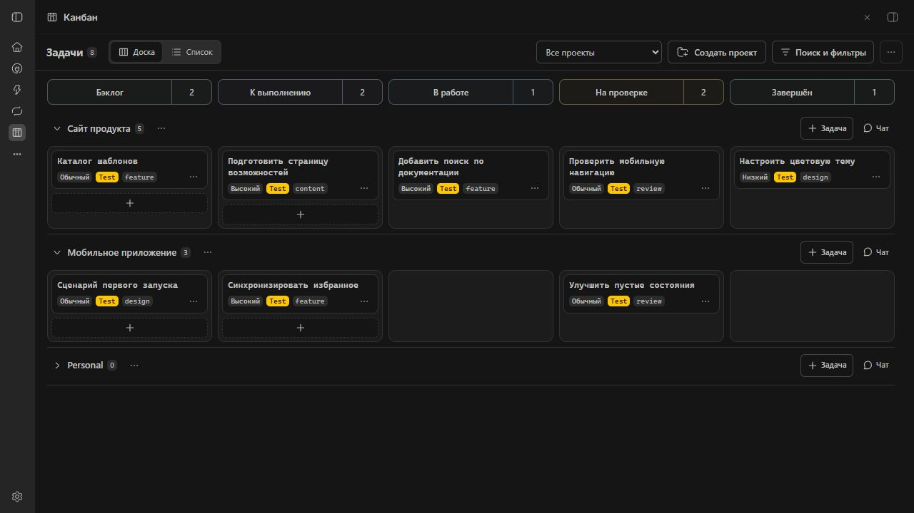
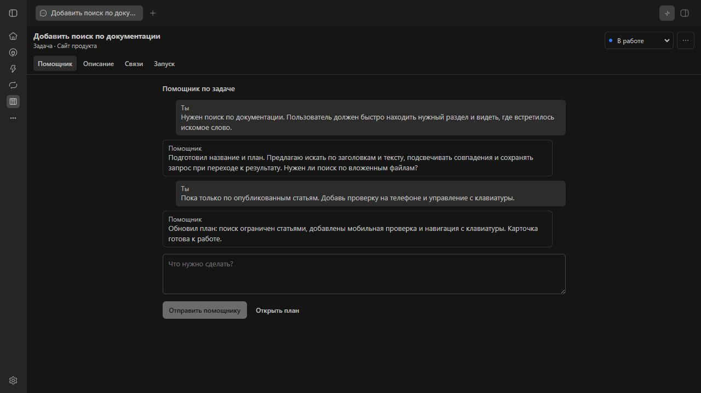
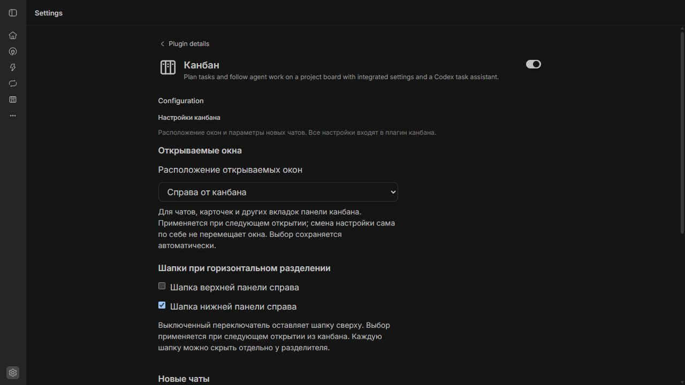
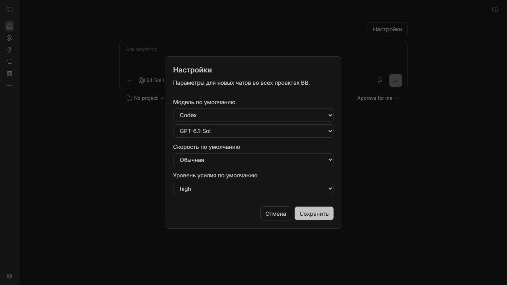

# Канбан задач BB

Планируйте задачи, следите за работой агентов и получайте уведомления в одном плагине.

```powershell
bb plugin install git:https://github.com/andrey-khudoley/bb-plugin-thread-kanban.git
```

При установке версии по тегу на Windows используйте форму `@semver:0.3.x`,
когда теги этой серии опубликованы: она не требует специального символа `^` в командной строке.

## Установка одного плагина

Требования: BB 0.49 или новее и Plugin SDK 0.6.132 или новее. Настройки и помощник входят в этот пакет; отдельные `chat-defaults` и `workspace-deploy` не нужны. Для помощника требуется установленный и авторизованный Codex на машине, где BB запускает агента. Его использование расходует лимиты или оплачивается по условиям собственного аккаунта пользователя. Сам плагин не поставляет доступ к модели.

После распаковки подготовленного релиза откройте PowerShell в папке пакета:

```powershell
npm install --omit=dev --omit=optional --ignore-scripts
bb plugin install .
```

При размещении этого пакета внутри другого репозитория укажите `--subdirectory bb-plugin-thread-kanban`. Скопированная папка должна оставаться на диске: path-установка читает её напрямую. Для сборки из исходников нужны npm и доступ к зависимостям.

После установки откройте «Канбан» в навигации и «Настройки → Настройки канбана». Каждый пользователь работает с собственной базой BB. Плагин не публикует доски, карточки или чаты в интернет и не меняет настройки доступа сервера.

### Обновление со старой пары плагинов

Перед первым открытием настроек новой версии оставьте старый `chat-defaults` включённым. Канбан однократно переносит модель, усилие, скорость, расположение окон и шапок в своё хранилище. При ошибке чтения перенос не записывает неполные данные; после исправления его можно повторить. Откройте новые настройки, сверьте значения и отключите старый плагин:

```powershell
bb plugin disable chat-defaults
```

После переноса старый плагин не требуется. Новые изменения сохраняются только в канбане. Перенос не удаляет старое хранилище. Если старый плагин уже отключён до переноса, канбан попросит временно включить его; новые установки без него сразу получают стандартные значения.

## Мобильные шапки

На телефоне переключатель «Доска / Список» виден над выбором проекта, фильтрами и меню «…». В канбане следующий ряд показывает текущий этап с числом карточек. Стрелки переключают соседние этапы одним нажатием; нажатие на название открывает полный вертикальный список с цветами, счётчиками и отметкой текущего этапа. На первом и последнем этапе соответствующая стрелка отключена. Поиск, подробные фильтры и сортировка доски раскрываются в общей панели; её кнопка сохраняет описание и число активных ограничений. Выделение карточек и слияния также доступны через «…». В режиме списка ряд этапов не нужен. Настольные узкие панели сохраняют полосу этапов.

Шапка рабочего чата содержит однострочное название с собственной горизонтальной прокруткой, этап задачи и меню действий. Во второй строке находятся разделы и инструменты чата. Связи и переключение между несколькими чатами задачи доступны в меню действий. Подразделы задачи на телефоне объединены в переключатель второй строки. Название можно прокрутить пальцем или клавишами после фокусировки; кнопки остаются на месте.

Мобильные правила находятся в `mobile-headers.css`, действуют до 760 px и на сенсорных экранах до 950 px в альбомной ориентации. Кнопки шапок имеют область нажатия не менее 44 px по высоте; размеры строк могут расти вместе с текстом. Настольная компоновка и нижняя панель не изменяются. Проверки меню: `node --test --test-force-exit mobile-headers.test.mjs`.

## Переход к открытой карточке

Переход из колокольчика на видимом канбане выбирает существующую вкладку карточки
или открывает карточку в боковой панели этой же доски, сохраняя фильтры и основной
экран. Для результата работы или вопроса показывается именно связанный чат
в разделе «Чат», даже если прежде были открыты изменения или другой чат задачи.
Ссылка созданной карточки в уведомлении порождения тоже открывает её на этой доске.
В обычном режиме чата колокольчик открывает штатный чат BB; скрытый канбан
переход не перехватывает. Карточка без чата открывается без создания нового чата.

Обычный клик по карточке выбирает её уже открытую вкладку в боковой панели текущей поверхности канбана. Текущая вкладка сохраняет свою карточку. Повторный клик по активной карточке не открывает её заново и не сбрасывает выбранный раздел. Если карточки среди вкладок нет, сохраняется прежнее открытие в текущей вкладке.

Если открыто несколько копий, выбирается активная подходящая вкладка, затем последняя активированная; после восстановления без истории — первая в списке BB. Закрытые вкладки и вкладки, уже перешедшие на другую карточку, не учитываются. Сопоставление использует тип и ID карточки, а не её заголовок. Поиск ограничен текущим контроллером боковой панели, без перехода в другие окна BB.

Нативный `+` / Ctrl+T и пустая вкладка канбана сохраняют явное открытие новой копии. Ctrl/Cmd-клик по карточке по-прежнему выделяет её. Переход к конкретному связанному чату остаётся явной навигацией. В пределах сессии вкладки сохраняют разделы, параметры просмотра изменений и прокрутку собственных областей канбана; буферы файлов и прокруткой встроенного чата управляет BB.

Проверки: `node --test panel-card-navigation.test.mjs panel-view-state.test.mjs`.

## Режим «Список»

Каждый проект объединяет строки задач и самостоятельных чатов. Пустые этапы не занимают место: этап подписан в каждой строке. На телефоне сначала читается полное название, затем статус и краткий контекст, затем отдельные «Подробнее» и «Действия». На широком экране эти сведения выстроены по колонкам; дата обновления помогает сравнивать строки. Перестроение зависит от ширины самой панели, включая разделённое окно BB.

Название и свободный фон открывают существующую карточку или чат. «Подробнее» раскрывает родителя, ветку, метки, приоритет, исполнителя и состояние рабочей копии. Кнопки в раскрытии, меню и флажок выбора работают самостоятельно. В режиме выбора название и фон переключают выбор; меню и раскрытие сохраняют своё назначение. Основные сенсорные цели списка — не меньше 44×44 CSS px, функции не требуют наведения курсора.

Поиск и сортировка доступны прямо над списком и используют те же значения, что фильтры доски. Поиск учитывает также описание, план и метки. Сортировка по активности, созданию и приоритету действует внутри проекта сразу для всех этапов и обоих видов карточек. Ручной порядок сохраняет этапы и порядок задач внутри них; перетаскивание мышью и перенос выбранных задач остаются доступны. Кнопка «Задача» создаёт карточку в бэклоге. Меню проекта также позволяет создать задачу к выполнению и новый чат; на тесном экране отдельная кнопка чата может быть убрана в это меню.

Переключение вида сохраняет фильтры, сортировку и выбор. Прокрутка для каждого вида и набора фильтров, а также свёрнутые проекты хранятся в пределах сессии вкладки: возврат из дерева и обновление страницы восстанавливают контекст. Загрузка, ошибка с повторной попыткой, пустой проект и отсутствие результатов имеют отдельные состояния.

Проверки поведения: `node --test --test-force-exit task-list.test.mjs projects-ui.test.mjs`. Полный набор: `node --test --test-force-exit *.test.mjs`. UI-аудит выполняется на 320, 390, 768 и 1440 CSS px; сенсорная эмуляция не заменяет проверку на реальном устройстве или с пользователями.

## Проекты

Кнопка «Создать проект» находится рядом с выбором проекта и оформлена как остальные действия верхней панели. На узком экране она показана значком папки с плюсом с доступным именем «Создать проект». Кнопка доступна и на пустой доске, и при любых фильтрах. Форма требует название, подключённый компьютер и полный путь к существующей папке. Перед созданием форма проверяет доступность папки через API BB, затем создаёт проект публичным API с правами текущего пользователя. Ошибки показаны в форме, повторная отправка во время сохранения заблокирована. Создание, отмена и ошибки сохраняют текущий выбор проекта и фильтры. Новый проект сразу добавляется в список; перейти к нему с очисткой фильтров карточек можно явным действием «Показать проект» в уведомлении об успехе. Форма поддерживает Enter, Escape и возврат фокуса к кнопке.

Рядом с названием проекта есть меню «…»: «Переименовать», «Убрать проект…», «Поднять выше» и «Опустить ниже». Переименование меняет имя проекта в BB, пустое название запрещено. У системного Personal переименование и удаление недоступны.

Порядок проектов задаётся вручную и хранится на сервере плагина для всего канбана. Перемещение меняет позицию на одну; новые проекты добавляются в конец. Группы, убранные в Personal, пропускаются при перемещении соседних проектов. Сортировка карточек и фильтры не меняют порядок проектов.

Действие «Убрать проект…» проверяет все чаты, включая архивные и скрытые. Если чаты есть, задачи и чаты проекта показываются в группе Personal только внутри канбана; исходная принадлежность, рабочие окружения и связи сохраняются. Вернуть отдельную группу можно через меню Personal → «Вернуть проект в канбан…». Эта настройка хранится на сервере плагина. Новые задачи и чаты из группы Personal создаются в Personal; карточка, созданная из существующего чата, сохраняет проект этого чата.

Если чатов нет, диалог предлагает удалить проект из BB. После штатного удаления все его задачи сохраняются в Personal с прежними связями. Перед выполнением сервер повторяет проверку; при изменении состава или названия потребуется новое подтверждение. Отмена не меняет проект и карточки. Ядро BB для этих действий не модифицируется.

Проверки меню проектов: `node --test --test-force-exit projects.test.mjs projects-ui.test.mjs` после `bb plugin build`. UI-тесты используют официальный SDK harness и jsdom; они не заменяют проверку установленной сборки BB.

## Расположение открываемых окон

В «Настройки BB → Настройки канбана» доступен выбор «Расположение открываемых окон»: «Справа от канбана» (по умолчанию), «Под канбаном» и «Над канбаном». Выбор автоматически сохраняется на сервере в собственном хранилище канбана и переживает перезапуск. Он применяется при следующем открытии или активации вкладки из канбана; сохранение настройки само по себе не перестраивает открытые области.

Настройка относится к общей панели канбана: рабочим чатам, карточкам, файловым вкладкам, терминалам и встроенному браузеру. Переходы по разделам доски и внешние ссылки сохраняют штатное назначение. Вкладки повторно используют существующую область, включая её внутренние секции. Разделитель вертикальных режимов можно перетаскивать или менять клавишами ↑/↓, Home/End; его положение сохраняется на устройстве. Открытия вне канбана не меняются.

Внизу всего окна находится одна общая строка состояния высотой 26 px, вне областей разделения. Отдельных полос «Активность агента» у доски и карточек нет. Строка сохраняется без сплита, при обоих направлениях разделения и свёрнутом сайдбаре. Оболочка резервирует её высоту, поэтому содержимое не перекрывается.

Слева доступны проект активного чата (при наличии — ветка), списки работающих и ожидающих пользователя чатов. Используется существующий живой источник `experimental_useSidebarThreads` и правила `stageOf`, без дополнительного опроса чатов. Учитываются все неархивные чаты этого источника, включая скрытую фоновую работу; ID чата учитывается один раз независимо от числа вкладок. Выбор уже открытого чата фокусирует его вкладку или нативную область.

Справа колокольчик объединяет прежнюю историю порождения/декомпозиции с непрочитанными результатами чатов. Этапы, ошибки, созданные карточки и переход в дерево сохраняются. История запусков общая для окна, мигрирует из прежних записей сессии и опрашивается одним компонентом на запуск, даже при закрытом колокольчике.

Рядом отображаются текущие лимиты и штатные значки сервисов. Адаптер использует существующие кнопки и единственный компонент Provider usage с его кэшем и расписанием обновления. В строке показан максимальный процент использования из доступных лимитов; подробности сохраняют разбивку по аккаунтам и периодам. Если BB закрывает подробности при навигации, строка сохраняет последнее полученное значение с пояснением в подсказке; открытие подробностей обновляет данные штатным способом. «…» означает загрузку, «—» — отсутствие данных, «ошибка» — неудачную загрузку. Сервисы не монтируются повторно, их DOM не перемещается. При отключении плагина исходный футер и размеры оболочки восстанавливаются. В узком окне подписи сокращаются, сервисы доступны через меню «Плагины и сервисы»; счётчики, лимиты и колокольчик остаются видимыми. Кнопки поддерживают Tab, Enter, пробел, стрелки, Home/End; раскрытия закрываются Escape.

У разделителя находятся две независимые кнопки «Верхняя: скрыть / показать» и «Нижняя: скрыть / показать». Они управляют только шапкой соответствующей физической области; содержимое и поле ввода не размонтируются. Кнопки доступны мышью и с клавиатуры. Оба состояния запоминаются на устройстве и сохраняют привязку к верхней/нижней области при смене расположения канбана. Прежнее общее состояние скрытия переносится в обе области.

В «Настройки канбана → Открываемые окна → Шапки при горизонтальном разделении» отдельно включается «Шапка верхней панели справа» и «Шапка нижней панели справа». По умолчанию верхняя шапка остаётся сверху, нижняя располагается в вертикальной боковой панели справа. Настройки хранятся на сервере и применяются при следующем открытии из канбана. Боковые панели прокручиваются независимо от основного содержимого; нативные вкладки и действия сохраняются. При открытии справа от канбана используются штатные горизонтальные шапки.

В SDK 0.6.132 нет API направления панели. Проверяемый адаптер меняет направление только существующей пары «канбан / панель», сохраняя нативные вкладки, редакторы и внутренние сплиты. Он не перемещает DOM-узлы и не обращается к внутренностям React. При неизвестной разметке или компактном режиме BB без разделяемой панели остаётся штатный интерфейс. При уходе с канбана адаптер удаляется.

## Вкладки панели

Верхний штатный «+» открывает новую вкладку. Кликните по карточке на канбане, чтобы открыть её в выбранной вкладке. Последующие клики заменяют карточку в этой же вкладке; остальные явно открытые вкладки сохраняются. Заголовок вкладки показывает название текущей карточки и обновляется при её замене и переименовании. Дублирующей кнопки создания вкладки внутри карточки нет. Нативное оформление, закрытие, перемещение вкладок, разделение на секции, изменение размеров и максимизация остаются штатными средствами BB.

Под основной строкой вкладок появляется строка «Материалы» текущей вкладки: браузеры чата, открытые файлы, терминалы и другие нативные артефакты BB. Без материалов строки нет. Нажатие на «Материалы» раскрывает под строкой список с поиском по названиям и путям. Список занимает собственное место в панели и сдвигает содержимое вниз, поэтому нативный браузер не перекрывает его. Повторное нажатие, выбор материала или Escape закрывают список. Тип, полное название и путь доступны также в подсказке. Строка прокручивается колёсиком мыши и горизонтальным жестом тачпада; Ctrl + колёсико сохраняет масштабирование. Стрелки, Home и End переключают вкладки, Delete закрывает выбранный материал. Кнопка «Чат» или «Карточка» возвращает к основной вкладке. После закрытия активного материала выбирается соседний, после последнего строка исчезает. Выбор сохраняется отдельно для каждой основной вкладки и карточки на время сеанса.

Файлы остаются штатными редакторами BB и привязаны к карточке. При переходе к другой карточке показывается её набор файлов; возвращение восстанавливает прежний набор и выбранный редактор. Он сохраняется при переходе между чатом и настройками карточки и доступен при её открытии в другой вкладке. Плагин не записывает содержимое файлов; буферы и защита несохранённых правок при закрытии остаются у BB. Черновики полей карточки и заметок чата сохраняются отдельно. Содержимое основных вкладок, раздел карточки и принадлежность файлов переживают перезагрузку интерфейса. Карточки чатов в открытых вкладках выделяются мягкой тенью, включая неактивные вкладки и секции. Открытые настройки карточки не дают подсветку чата.

Браузерные сессии обнаруживаются через `experimental_desktopBrowsers` на локальном компьютере и компьютере окружения чата, включая `presentation: hidden`. Выбор материала подключает существующий BrowserView по ID с `existingOnly: true`; переключение скрывает представление, сохраняя страницу, cookies и управление агента. Кнопка «Перехватить» явно отдаёт управление пользователю. Само открытие материала не получает и не отзывает lease агента. Закрытие материала закрывает соответствующую настоящую вкладку.

SDK 0.6.132 предоставляет список, выбор и закрытие нативных вкладок, но не предоставляет компонент встраивания BrowserView или API строк в панелях. Поэтому разметка основной строки дополняется отдельным React portal без переноса нативных DOM-узлов, а `desktop-browser.ts` изолирует проверяемый по возможностям адаптер `window.bbDesktop.browser`, используемый установленным desktop BB. Реальные браузерные страницы видны в том же desktop-окне, где создана сессия. В веб-клиенте или другом окне выводится объяснение; новый браузер взамен существующего не создаётся. После обновления BB адаптер требует живой проверки. Вкладки с одинаковыми названиями внутри одной панели остаются отдельными материалами: выбор и закрытие используют ключи BB, подписи получают номера. Если одинаковые подписи распределены между разными split-панелями и SDK не позволяет определить принадлежность, нативные элементы сохраняются на месте. Один и тот же нативный файловый редактор BB может переиспользовать между панелями; независимые копии его буфера требуют поддержки ядра.

SDK 0.6.132 не предоставляет идентификаторы секций или API владения редакторами. Плагин использует проверяемое оформление нативной панели через content script; при изменении её разметки или неоднозначных названиях вкладок оставляет штатные элементы доступными. BB может переиспользовать уже открытый файл в другой секции; независимые копии такого редактора и расширенные гарантии восстановления несохранённых файлов после полного перезапуска требуют поддержки ядра. Плагин ядро не меняет.

Карточка фактически выбранной вкладки получает немного более плотный фон и внутреннюю рамку того же цвета темы. Остальные открытые чаты сохраняют мягкую подсветку, неоткрытые — обычный вид. Акцент следует за `experimental_usePanelTabs().selectedKey` и текущим контекстом вкладки, включая замену карточки или рабочего чата без смены ключа. Файловая, пустая вкладка и настройки задачи не получают усиленный акцент чата. Подсветка не меняет цвет текста, метки статуса и рамку множественного выбора; поддерживаются светлая, тёмная темы и системный режим контрастности.

Целевые проверки: `node --test panel-context.test.mjs panel-tab-selection.test.mjs panel-tab-labels.test.mjs panel-native-tabs.test.mjs open-chats.test.mjs open-chats-ui.test.mjs panel-drafts.test.mjs agent.test.mjs`, `tsc --noEmit`, `bb plugin build .`.

## Инструменты агента и MCP

Плагин предоставляет семь инструментов всем агентам BB:

| Инструмент | Результат |
| --- | --- |
| `kanban_snapshot` | Данные сервера: проекты, колонки, задачи и самостоятельные чаты, связи и запуски. Фильтры `projectId`, `stage`, `query`, `includeArchived`, `includeHidden`; страницы `limit` до 200 и `offset`. При достижении предела сканирования возвращается `truncated`. |
| `kanban_card_get` | Карточка, подзадачи и запуски; для чата передайте `kind: "thread"`. |
| `kanban_diagnostics` | Установленная ревизия и дерево пакета, хеш frontend, deployment, живые окна и ошибки. |
| `kanban_ui_snapshot` | Свежий ответ настоящего интерфейса: фильтры, колонки, карточки с координатами, действия, панели, меню, ошибки и поколение frontend. |
| `kanban_ui_open` | Открытие реального канбана в собственной вкладке встроенного браузера BB. Нужны явные `hostId` и `instanceId`; возвращается `windowId`. |
| `kanban_ui_capture` | Настоящий JPEG вкладки наблюдения по `windowId`; в MCP и native tool передаётся как изображение. |
| `kanban_ui_close` | Закрытие собственной вкладки наблюдения. |

Инструменты используют существующие данные и правила этапов канбана. Связанный чат не дублируется самостоятельной карточкой. `kanban_card_get` возвращает последние 20 сообщений постановки; `messageLimit` до 50 и `messageOffset` позволяют прочитать более ранние страницы. Большие списки запусков и подзадач имеют явные счётчики и признаки ограничения. Серверный снимок не подтверждает отображение: для этого нужен `kanban_ui_snapshot`. Там `cards` содержит отрисованные карточки, а `inViewport` учитывает прокрутку и обрезание родителями. Снимок запрашивается заново по идентификатору запроса. При нескольких окнах возвращаются до четырёх отчётов и список идентификаторов для точечного запроса. `board_closed` и `no_window` явно обозначают отсутствие открытой доски или ответа окна; старые отчёты не выдаются за свежие.

Вкладка наблюдения показывает настоящее приложение и установленный плагин, с отдельными настройками отображения. Она не управляет исходным окном пользователя. Захват использует публичный `experimental_desktopBrowsers.captureTab`, работает на Windows без DevBrowser и требует открытого desktop BB. На удалённой машине нужен доступный с неё адрес BB (`BB_APP_URL`). Вкладки автоматически закрываются при выгрузке плагина или через 30 минут; одновременно допускается восемь. Существующие карточки и Git эти инструменты не изменяют.

Native tools подключаются при следующем построении сеанса агента. Во время уже начатого сеанса те же операции доступны через `bb plugin rpc call thread-kanban agentSnapshot --input-file <json> --json`. Схемы: `bb plugin rpc inspect thread-kanban`.

### Внешний MCP-клиент

MCP-сервер запускается через stdio из стабильной папки исходников с установленными зависимостями. Пример настройки клиента на этом компьютере:

```json
{
  "mcpServers": {
    "bb-kanban": {
      "command": "node",
      "args": ["C:/BBPlugins/bb-plugin-thread-kanban/mcp.mjs"]
    }
  }
}
```

`npm ci --include=dev` устанавливает зависимости; `npm run mcp` запускает сервер вручную. На другой машине замените абсолютные пути. Если BB доступен через другой адрес, задайте `BB_SERVER_URL` штатным способом CLI. Секреты не нужны в конфигурации MCP: адаптер использует авторизованный локальный CLI. Для изолированного QA предусмотрен `KANBAN_PLUGIN_ID`. Для открытия вкладки из внешнего клиента передайте `threadId` существующего чата; в сеансе BB он подставляется автоматически. Адаптер использует официальный MCP SDK v2, общие с native tools схемы и проверяемый RPC. Сетевой порт не открывается.

Проверки после сборки:

```powershell
npx tsc --noEmit
bb plugin build
npm run test:agents
bb browser instances --host <host-id> --json
node scripts/smoke-agent.mjs <host-id> <instance-id> <папка-доказательств>
```

Последняя команда подключает настоящий MCP-клиент по stdio, читает данные и диагностику, открывает канбан, получает DOM-снимок и JPEG, закрывает свою вкладку и сохраняет `kanban-agent-evidence.json` и `kanban-agent-capture.jpg`. Для запуска smoke-проверки нужны devDependencies; для самого MCP достаточно production dependencies. Запускайте код из стабильной папки репозитория, а не из удаляемой папки установленного релиза.

Кнопка «Проверено» во вкладке «Изменения» сохраняет незакоммиченные правки текущего Git-окружения и переводит карточку из «На проверке» в «Завершён». Если у карточки несколько рабочих папок, заверши проверку каждой с незакоммиченными правками. Коммиты канбана используют заголовок `prefix: title` и список изменённых файлов в теле.

«Вся работа» показывает итоговый diff выбранного worktree от его исходной ревизии до текущих файлов, включая коммиты и незакоммиченные правки. Канбан хранит патч отдельно от worktree и фиксирует версию рабочей ветки при слиянии. Старые работы восстанавливаются, когда сохранились исходная ревизия и состояние рабочей ветки. Для общей рабочей папки без подтверждённой точки начала доступен режим «Рабочая копия».

В общей рабочей папке история чата исключает вспомогательные файлы вне репозитория, например отчёты и скрипты из хранилища чата. Правки из другого зарегистрированного Git worktree того же репозитория учитываются по их путям внутри репозитория. Внешние пути не сопоставляются по одному лишь совпадению имени файла.

Откройте «Канбан» в левой панели BB. Проекты идут сверху вниз. Самостоятельные карточки проходят этапы «Бэклог», «К выполнению», «В работе», «На проверке», «Завершён» и «Отменён». Последнюю колонку показывает переключатель «Отменённые». Статус можно изменить в карточке или перетаскиванием. Режим сортировки «Вручную» позволяет менять порядок внутри колонки.

Нажмите на заголовок колонки, чтобы свернуть её для всех проектов. Компактный заголовок показывает номер этапа и общее число карточек с учётом фильтров, а вертикальная полоса в строке проекта показывает его счётчик. Карточки можно перетащить в свёрнутую колонку. Канбан запоминает состояние колонок в текущем браузере.

На узком экране или при сужении доски боковой панелью можно выбрать один этап над списком проектов. Переключатель «Список» показывает все этапы вертикально. Настройки поиска и отображения собраны в «Фильтрах». В карточке задачи есть разделы «Обзор», «Чат», «Связи» и «Запуски», а дополнительные действия с чатом доступны в меню рядом с кнопкой боковой панели.

Карточка отдаёт всю ширину заголовку. Длинное название занимает до двух строк. Полный текст доступен при наведении и в открытой карточке, а действия и метки расположены под названием.

Нажмите «+ Задача» рядом с названием проекта, выберите «Бэклог» или «К выполнению» и опишите работу в чате постановки. Временный скрытый сеанс Codex готовит название и план. Отредактированные вручную поля сохраняются при следующих ответах, пока вы сами не включите автообновление. Карточка и обсуждение сохраняются в базе плагина. «Запустить работу» создаёт связанный чат и отправляет в него сохранённую постановку. Можно добавить несколько чатов, привязать уже существующий или начать с форка. При завершении последнего активного запуска карточка из «В работе» переходит в «На проверке». Статус «Завершён» выставляется вручную.

В карточке можно задать исполнителя, приоритет и метки, создать подзадачу, выбрать родителя, указать блокирующие задачи, дубликат и связанные карточки. Существующий чат можно преобразовать в самостоятельную карточку через меню чата.

В разделе «Запуск» новый чат получает модель, усилие и скорость из сохранённых настроек канбана. Поля «Уровень усилия» и «Скорость» позволяют переопределить их для одного запуска; после успешного создания чата они возвращаются к наследованию. Сервер перечитывает настройки при каждом запуске и проверяет поддержку выбранных параметров в его окружении. Если уровень усилия или скорость недоступны, показано объяснение и чат не создаётся до выбора поддерживаемого значения. Форк наследует параметры исходного чата.

В меню карточки раздел «Подзадачи из контекста» позволяет породить одну задачу по описанию или разложить исходную задачу на несколько. В декомпозиции можно уточнить этап или оставить поле пустым, чтобы разобрать всю задачу. Для карточки анализируются её поля, чат постановки и последний привязанный рабочий чат. Агент готовит название, описание, план, метки, приоритет, промпт запуска и фрагменты из переписки. Промпт можно исправить, а фрагменты убрать перед запуском.

Новые карточки появляются в «Бэклоге» или «К выполнению» и вкладываются в исходную. Если источником был обычный чат, канбан привязывает его к родительской карточке. «Открыть ветку задачи» показывает дерево с переходом к предкам и сворачиванием уровней. Подзадачи можно снова породить или декомпозировать из этого дерева.

«Открыть ветку чата» показывает все уровни дочерних чатов, включая архивные. Из меню дочернего чата можно сфокусироваться на его ветке, а по пути над деревом вернуться к любому предку. Клик по строке чата открывает его рядом с деревом. «Ветка задачи» ведёт к карточкам, связанным с этим чатом. «Создать форк чата» создаёт вложенный чат с контекстом исходной переписки, а «Переместить чат в ветку» позволяет выбрать для чата родителя из его проекта.

Клик по карточке задачи или её названию открывает связанный чат рядом с доской. Для карточки без чата открывается «Описание». Раздел «Задача» объединяет описание и план задачи, связи, запуски, уточнение задачи и заметки рабочего чата. В «Изменениях» доступны история Git, связанные PR и замечания по файлам. Терминал, превью по ссылке и ветка рабочего чата находятся в меню «Инструменты».

У карточок с отдельной веткой есть отметка «Worktree». Если коммиты ветки уже входят в `main` и в рабочей копии нет правок, отметка меняется на «В main». В рабочей области «Изменения» открывает сравнение worktree с `main` и показывает кнопку «Слить в main».

Кнопка «Слияния» в шапке доски открывает планы и пакетные действия. Там «Слить готовые» собирает ветки с этапов «На проверке» и «Завершён» в выбранном проекте или во всех проектах. «Слить выбранные» появляется при выборе карточек галочками или через Ctrl+клик на доске либо в дереве. Агент предлагает порядок для нескольких веток по зависимостям, вложенности и спискам файлов. Во вкладке «Слияния» можно проверить порядок, пропущенные ветки и подтвердить слияние.

Для слияния закоммить изменения в worktree и открой чистую `main` в основной папке проекта. Канбан пробует весь набор веток репозитория во временном worktree и обновляет `main` после успешной проверки. Агент объединяет совместимые текстовые изменения и описывает свои решения во вкладке «Слияния». Когда нужно выбрать вариант, канбан сохраняет вопрос, приостанавливает этот пакет и продолжает после ответа. Результат выводится отдельно для каждого репозитория.

Во вкладке «Слияния» блок «Следующий шаг» показывает, что нужно сделать с текущим планом. При незакоммиченных правках там видны ветка, список файлов и кнопка коммита. Если папка занята, панель показывает чаты, которые её используют, и проверяет готовность автоматически. После коммита план обновляется. «Обновить план» и «Удалить план» доступны в меню плана. Повторный запуск для той же подборки открывает существующий незавершённый план.

Поиск учитывает заголовок, описание, план и метки. Есть фильтры по проекту, приоритету, метке, исполнителю и ожидающему вводу. Задачи можно показать списком или выбрать несколько карточек и перенести их на другой этап вместе.

В меню завершённого чата выберите «Архивировать чат». Карточка задачи тоже скрывается, когда все её связанные чаты в архиве. Чтобы увидеть архивные карточки на их этапах и вернуть чат на доску, включите «Показывать архивные чаты» в меню «Фильтры» и выберите «Разархивировать чат». Архивные чаты также доступны в дереве чатов и открываются кликом по строке. Если архив разбит на страницы, используйте «Загрузить ещё из архива».

## Обновления и разработка

Плагин обновляется штатными средствами BB: «Настройки → Установленные плагины» или `bb plugin outdated` / `bb plugin update thread-kanban`. Установка из локальной папки закреплена за этой папкой; Git-ветка или диапазон версий позволяет получать обновления. Отключение плагина прекращает его работу на своей установке; удаление публичного репозитория не отключает копии, уже установленные другими людьми.

Метка «В main» на карточке относится к Git проекта пользователя и не показывает версию плагина. Контроллер `workspace-deploy` — отдельный необязательный инструмент разработчика. Канбан, настройки и помощник работают без него.

```powershell
npm ci --include=dev
npm run build
npm test
npm run typecheck
npm run release:check
```

Перед релизом проверяйте установку пакета в отдельном BB с пустым каталогом данных. Проверьте создание Test-карточки, помощника с собственным Codex, сохранение настроек и повторное открытие после перезапуска. Не используйте личную базу BB как содержимое релиза.

## Нижняя панель

Общая строка состояния и колокольчик входят в `thread-kanban`. Отдельный
`status-bar` не требуется. При первом обращении новая версия отключает прежний
плагин и однократно переносит его уведомления, прочтение, скрытие, позиции
обработки событий и настройки звука. Прежняя база открывается только для чтения
и сохраняется для отката. Уже доставленные события не доставляются повторно.

Подробнее: [строка состояния и уведомления](STATUS_BAR.md).

## Скриншоты

На всех изображениях использованы только демонстрационные проекты, Test-карточки и вымышленная переписка.








